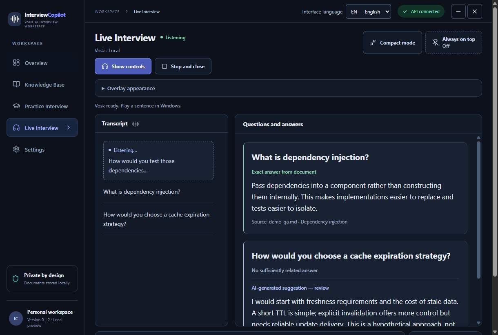
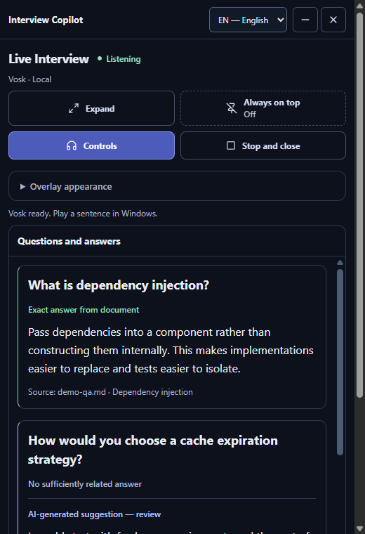
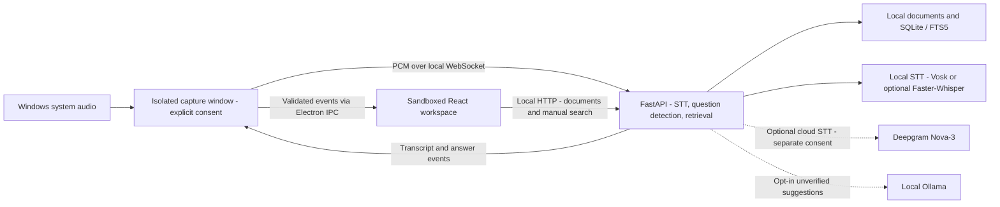

# Interview Copilot

**Your interview knowledge, in a focused Windows workspace.**

Interview Copilot is a desktop application for technical interview preparation and consent-based Live assistance in English and Spanish. It transcribes system audio, detects interview questions and retrieves document-backed answers, keeping optional AI suggestions visibly separate from evidence.


> **Windows development preview.** Live system-audio capture is development-only; packaged capture is disabled. Integrated Windows and conferencing acceptance remains incomplete. This is not a production-ready release.

[Features](#implemented-features) · [Screenshots](#live-workspace) · [Architecture](#architecture) · [Quick start](#windows-setup-cmd) · [Privacy](#privacy-security-and-limitations)

## Implemented features

- **Focused Live workspace:** expanded transcript and Q&A panels, a compact overlay and stable question cards enriched by correlated results; EN/ES interface controls.
- **Evidence-first answers:** normalized exact Q&A with sources, optional semantic Q&A labeled for review, then an explicit no-evidence result. Opt-in Ollama suggestions remain unverified and source-free.
- **Explicit STT selection:** local Vosk by default, optional local Faster-Whisper or Deepgram Nova-3 cloud streaming; no automatic provider switching.
- **Local Knowledge Base:** import XLSX, DOCX, PDF, TXT and Markdown; manage documents and search manually without invoking an LLM.
- **Basic Practice:** document questions, keyword-based feedback and session reports—not an AI assessment of technical correctness.

## Live workspace

**Actual Electron renderings with synthetic interview data and a mocked desktop bridge.** Connection, listening, transcript and answer states are simulated. No audio capture, backend, provider or model was used; these images do not validate native transparency or end-to-end behavior.

### Expanded mode

Transcript alongside a continuous Q&A queue, with document sources and unverified AI clearly distinguished.



### Compact mode

The same Q&A queue in a narrower, answer-first layout; the transcript stays open below it. Both feeds scroll independently. At the minimum window size, vertical page scrolling is still needed. The illustration below predates the permanently visible compact transcript.



## Technology stack

- **Desktop:** Electron 39, React 19, TypeScript, Vite and Lucide icons. The main renderer is sandboxed; audio capture uses an isolated window.
- **Backend and storage:** Python, FastAPI, Uvicorn and SQLite/FTS5. Documents and indexes stay local; no vector database service is required.
- **Speech:** Vosk is the local default. Faster-Whisper (local CPU INT8) and Deepgram Nova-3 (cloud) are optional.
- **Retrieval and generation:** optional FastEmbed semantic Q&A and opt-in local Ollama suggestions, disabled by default. Models and optional runtimes require separate setup; nothing switches providers automatically.

## Architecture



The backend owns provider access and credentials. React receives bounded Live events, never raw audio or keys. See [architecture and security boundaries](docs/architecture.md) for module responsibilities and lifecycle details.

## Windows setup (CMD)

Prerequisites: Windows, Python, Node.js/npm and local Vosk models. **Existing users:** reuse your working environment, database, documents and model caches; do not reinstall or reindex for validation.

First installation, from the repository root:

```bat
py -3 -m venv .venv
.venv\Scripts\python.exe -m pip install -r apps\api\requirements-live.txt
cd apps\desktop
npm install
```

Place the English and Spanish Vosk model folders in `local-data\models`, or set `COPILOT_MODELS_DIR`. Dependencies and models are not bundled or downloaded automatically. See [setup](docs/setup.md) for exact model names, storage paths and optional providers.

Start the backend from the repository root:

```bat
dev-api.bat
```

In a second terminal, from the repository root:

```bat
cd apps\desktop
npm run dev
```

The API listens at `http://127.0.0.1:8765`; Vite uses `http://127.0.0.1:5173`. Import Q&A documents in **Knowledge Base**, open **Live Interview**, then authorize capture with a real click inside the isolated audio window. Interface language and transcription language are separate settings. See the [Live guide](docs/live-mode.md) for controls, tray recovery and acceptance checks.

## Privacy, security and limitations

- **Capture scope:** system-audio capture includes **all Windows output**, not one selected application. Obtain participants' consent and follow organizational policies. The main renderer has no capture permissions.
- **Local data:** Live audio and transcripts are not persisted; in-memory histories are bounded, not a session archive. Imported documents and basic Practice answers are stored locally.
- **Cloud privacy and keys:** Deepgram sends audio off-device, requires separate informed consent, may incur charges and has its own processing/retention policies. Windows development Settings supports native key entry and Credential Manager storage; it distinguishes stored keys, the effective backend source and remote verification (not performed). Saving is not authentication. Deleting the Windows key leaves the higher-priority backend environment override unchanged. See the [setup guide](docs/setup.md#optional-deepgram-nova-3). `.env` is not loaded automatically. Never put keys in React, tracked files or screenshots.
- **Screen sharing:** main-window exclusion is **best effort**, never proof of invisibility. The auxiliary audio window is not protected; Teams, Zoom and Google Meet exclusion remains unverified.
- **Accuracy and acceptance:** STT and question detection can miss or combine speech. Full Spanish, latency, stop/restart, overlay and capture-continuity acceptance is pending. AI can invent claims; **AI-001C quality is not accepted**. Review all suggestions. Scanned-PDF OCR is not implemented; see [document-format limits](docs/setup.md#documents-and-retrieval).

**CLOUD-001:** Windows development key management is implemented; owner Windows acceptance is pending. **AI-002 Stage 2** adds separate local DeepSeek key management only; provider selection and cloud generation remain planned. Priorities belong in the [roadmap](docs/roadmap.md); actual acceptance evidence belongs in [Live Mode validation](docs/live-mode.md).

## Documentation

- [Setup and optional integrations](docs/setup.md) · [Architecture](docs/architecture.md)
- [Roadmap](docs/roadmap.md) · [Validation evidence and known limitations](docs/live-mode.md)
- [Visual design reference](DESIGN.md) · [Technical vocabulary](docs/technical-vocabulary.md)
- [Audio lab](docs/audio-lab.md) · [Transcription lab](docs/transcription-lab.md)
- [Development rules and regression commands](AGENTS.md)
